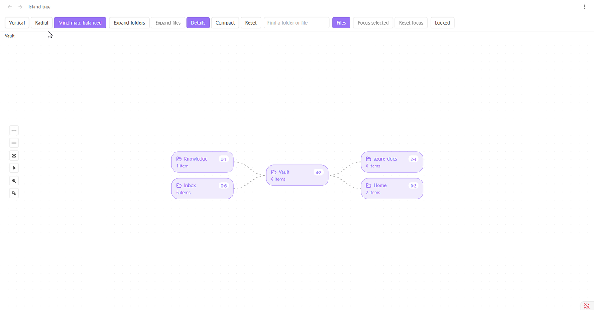

# Island tree

An Obsidian plugin that shows your vault's folders and files as an animated, canvas-style dashboard: rounded "island" cards joined by curved, flowing branches, in a vertical, radial or mind map layout on a dotted grid.

> **Status: pre-release (0.1.0).** Everything described below is built and tested in a browser against Obsidian's own stylesheet, but it has not had a full run in a range of real vaults yet. Please try it in a copy of your vault first, especially editing. See [`PROGRESS.md`](PROGRESS.md).

## Features

- Three layouts: vertical, radial and mind map (balanced or one-sided), on a dotted grid, with flowing branches.
- Pan and zoom that behave like Obsidian's Canvas, a zoom-to-area tool, and a Compact switch.
- Updates by itself when files change.
- Smooth on big vaults: tested with 10,000 notes, including one folder holding 10,000. See [`docs/PERFORMANCE.md`](docs/PERFORMANCE.md).
- Search that suggests as you type, like Obsidian's quick switcher, and loads only the one card you choose.
- Cards showing file type, link counts, tags, status, modified date and size, each switchable.
- A saved view: one click saves where you are looking, and another brings you back from anywhere, separately for each layout.
- Auto-scroll for reading hands-free: Shift and Space starts and pauses it, Shift and an arrow key sets the direction, and the speed is a setting.
- Full keyboard use, screen reader labels and reduced motion support.
- Optional editing (rename, create, delete, drag to move, undo) behind a lock. The dashboard starts locked.
- Tabbed settings with presets, import and export.

## Screenshots

<!-- Add screenshots here once they are taken, saved in docs/images/, for example:

-->

## Install

From **Settings → Community plugins → Browse**, search for "Island tree" and install it (once it is listed). To install it by hand, download `main.js`, `manifest.json` and `styles.css` from the latest [GitHub release](../../releases) and put them in `<your vault>/.obsidian/plugins/island-tree/`, then turn the plugin on under **Settings → Community plugins**. To build it yourself, see [`docs/DEVELOPMENT.md`](docs/DEVELOPMENT.md).

## Use

- Click the network icon in the ribbon, or run **Open dashboard** from the command palette.
- Run **Open dashboard in sidebar** to open it in the right sidebar.
- Click a folder to open or close it. Click the small badge on a folder to show or hide its files. A folder lists its first 40 items (the **List limit** setting); click "+N more" to reveal the next 40, up to 1,000 in one folder. A search always finds the rest.
- **Keyboard:** Tab to the dashboard (one stop), then the arrow keys move through the cards, Right opens a folder and then steps into it, Left closes it and then steps out, Home and End jump to the first and last card, Enter opens a note (Ctrl or Cmd and Enter for a split) or focuses a folder or shows the cards behind a "+N more" card, and F shows or hides a folder's files. The view follows the selected card. Keys typed in a box, and Alt and Left (Obsidian's Back), are left alone. Screen readers hear each card's name, kind, whether a folder is open and what it holds. With reduced motion switched on in your system, the dashboard does not animate.
- **Mouse, as in Obsidian's Canvas:** scroll pans, Shift and scroll pans sideways, and Ctrl or Cmd (or Space) and scroll zooms, as does a trackpad pinch. Drag the background with the left, middle or right button to pan, or hold Space and drag to pan even from a card. Shift and 1 fits the view, like the fit button. If you prefer the wheel to zoom, change **Mouse wheel** in Settings, Layout. The fourth zoom button (a dashed rectangle) lets you drag a rectangle over any part of the graph and zoom to it; holding Shift while dragging does the same. Escape cancels.
- **Compact** in the toolbar is an on and off switch: it draws smaller cards with tighter spacing, to fit more on screen and keep text readable when **Fit** zooms out on a big vault. Your own sizes are never changed, so switching it off puts them back exactly. It is remembered, and also appears as **Density** in Settings, Layout.
- Use **Vertical**, **Radial** and **Mind map** to change the layout. Click **Mind map** again to switch between its balanced view (branches on both sides of the vault) and its one-sided view (everything grows to the right); your choice is remembered.
- **Expand folders** opens one more level each press (only the folders on screen), and once everything on screen is open it becomes **Collapse folders** and closes them all. **Expand files** lists the files of every open folder, and only works once you have focused on a folder (from the whole vault it would load too much); a single folder's own **Show files** badge works anywhere. **Reset** goes back to the start. Folders you have not reached are never built, which keeps a big vault fast.
- The dashboard follows your vault: new, renamed, moved and deleted notes appear without reloading.
- Turn on **Details** for bigger cards with a second row for notes: a dot for how recently it changed (green today, amber within a week, grey older), its age, size, number of links and its status. The status comes from a `status` property in the note. Zoom in to see the row; zoomed far out, cards shrink to a colour and a short name.
- Type in the search box to see the best matching **folders**, best first, with the matched letters picked out and where each one lives. Use the arrow keys or the mouse, and press **Enter** to go to the highlighted one. Only that card is loaded: its folders open, it is selected and highlighted, the view glides to it, and the rest of a long list stays behind its "+N more" card. The box clears and the keyboard moves to the dashboard, so **Focus selected** and the arrow keys work on it. While you type, the cards already on screen that match get a yellow highlight, and by default the others fade; turn that off with **Dim cards that don't match** in Settings, Layout. Escape closes the list, and a second Escape returns to the dashboard.
- The **Files** button next to the box (or **Search files too** in Settings, Layout) also finds files, by their exact name only, with or without the extension. A loose word never turns into thousands of files. Reset forgets the card you went to.
- Double click a folder to focus on it, or select one and use **Focus selected**. The breadcrumb and **Reset focus** take you back up.
- **Editing:** click **Locked** in the toolbar to unlock (or run **Toggle lock** from the command palette). An editing bar appears with **Rename**, **New note**, **New folder** and **Delete** for the selected card, and right-clicking a card offers the same. Drag a card onto a folder to move it. Every change shows a notice with **Undo** for about seven seconds. Links update through Obsidian, and deleted notes go to Obsidian's trash. The dashboard locks again by itself after a few minutes without changes (Settings, Editing).
- Double click a file to open it in a new tab (the default), or hold Ctrl (Cmd on a Mac) to open it in a split. **Open notes in** (Settings, Layout) can open it in the dashboard's own tab instead: then Obsidian's Back (the arrow, Alt and Left, or the mouse's back button) returns to the dashboard just as you left it. The dashboard also remembers how it was left across a restart.

No hotkeys are set by default. Assign your own in **Settings → Hotkeys**.

## Settings

Open **Settings → Island tree**. A live preview at the top shows each change as you make it, and an open dashboard follows too. The **Editing** tab sets whether the dashboard starts locked, when it locks again, whether dragging is allowed, when a big folder asks for confirmation, and whether deleting asks first.

- **Cards:** width, height, corner radius, border width, side padding and text size. Which details show (age, size, links, tags, status), whether details start on, and the name of the status property.
- **Lines and grid:** curve style (curved, step or straight), thickness, dash pattern, flow speed (0 stops the animation) and highlight colour. The grid behind the cards: dots, lines or none, with size, spacing, opacity and colour.
- **Layout:** the default layout, gap between cards, spacing between levels, ring distances for the radial layout, how many items a folder lists at first and reveals with each "+N more", and whether Expand folders and Expand files start on.
- **Presets:** Compact, Comfortable and Large, your own saved looks, resetting one tab or everything, and exporting or importing settings as JSON (file or clipboard). An import shows a summary and checks every value before anything changes.

An empty colour or a text size of 0 follows your Obsidian theme. Every setting has a reset button.

## Known limits

- Desktop only for version 1.
- One folder shows at most 1,000 cards (40 at a time), and the whole dashboard draws at most 1,500 at once. A card says how many are "not shown"; the search box finds them.
- Editing has been checked against a stand-in for the vault, not yet in many real vaults. Deleting a note can be undone (it comes back as a new file with its saved content); deleting a folder cannot, so use Obsidian's trash.
- The dashboard rebuilds its tree when files change, with a short wait to gather bursts of changes, so a very large paste takes a moment to show.
- Search matches file and folder names, not the text inside notes. It lists folders only unless Files is on, and then only exact file names, and it lists at most 8 suggestions (the rest are counted).

## Privacy

No network calls, no telemetry and no ads. The plugin reads your vault's file and folder names and the details Obsidian already keeps about notes (dates, sizes, links, tags and properties) to draw the cards. It changes files only when you unlock editing and rename, create, move or delete something, and it does that through Obsidian's own file functions. Its settings are stored in the plugin's own data file inside your vault. The dashboard remembers how it was left (which folders were open and so on) in Obsidian's workspace file, as every view does.

## Documentation

- [`SPEC.md`](SPEC.md): agreed design and milestones.
- [`docs/ARCHITECTURE.md`](docs/ARCHITECTURE.md): how it is built.
- [`docs/DECISIONS.md`](docs/DECISIONS.md): why it is built that way.
- [`docs/PERFORMANCE.md`](docs/PERFORMANCE.md): what was measured on big vaults and the limits that keep it smooth.
- [`docs/SUBMISSION.md`](docs/SUBMISSION.md): releasing and submitting the plugin (for the maintainer).
- [`docs/DEVELOPMENT.md`](docs/DEVELOPMENT.md): setup, commands and testing.

## Credits

The pan, zoom and canvas surface is built on [Svelte Flow](https://svelteflow.dev) by [xyflow](https://xyflow.com), used under the MIT licence. Its small on-screen credit is hidden in the dashboard, so it is credited here instead.

## Licence

[MIT](LICENSE)
